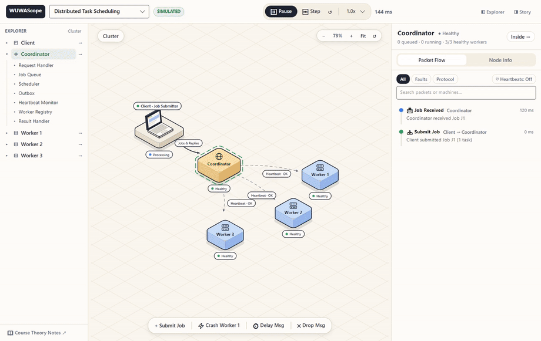
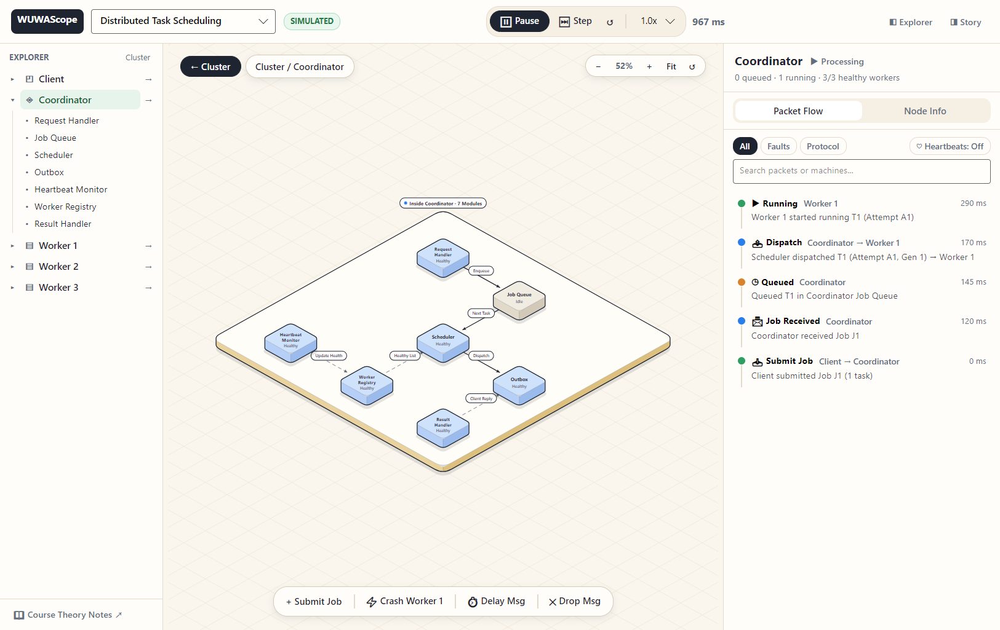
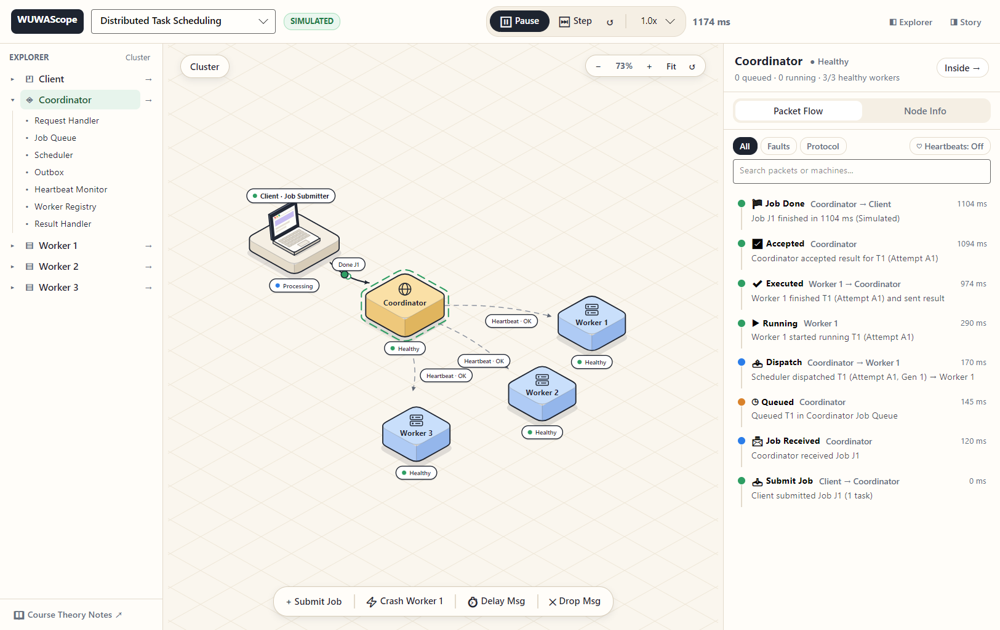
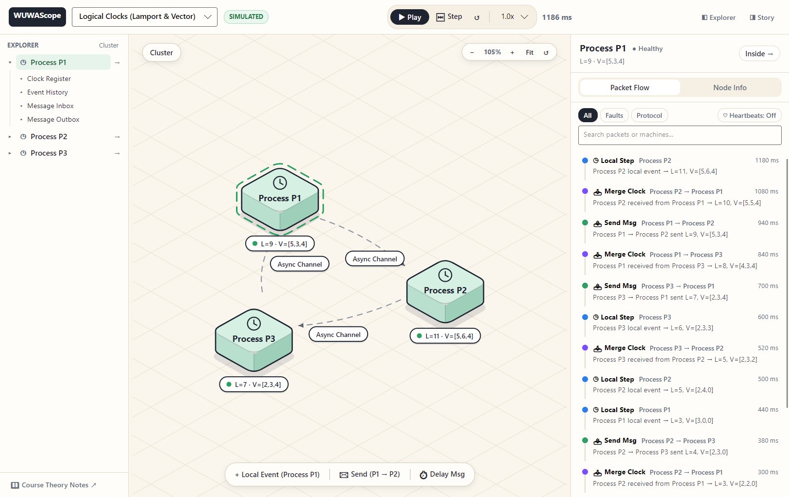
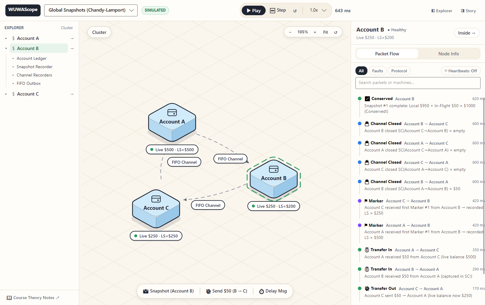
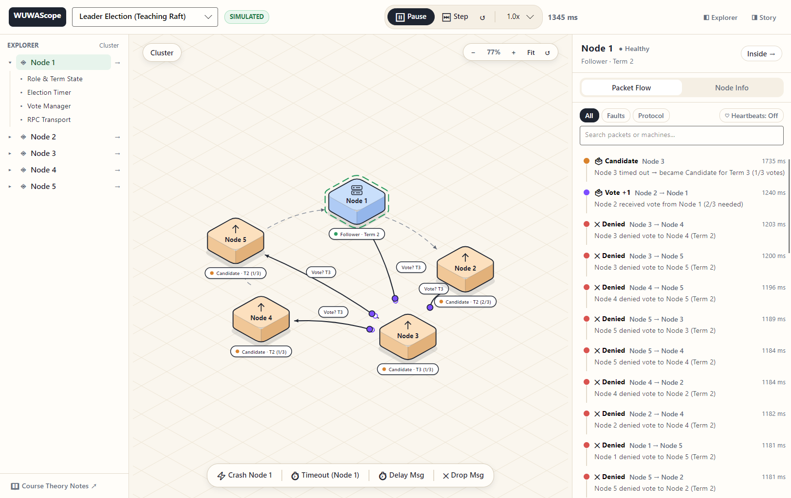
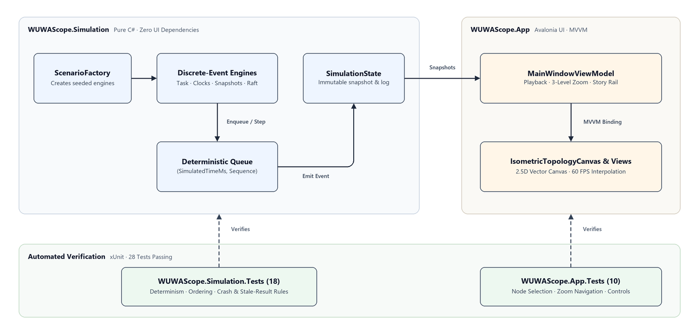

<div align="center">


# WUWAScope

**An interactive 2.5D desktop lab for watching distributed systems work — and break — step by step.**

[](https://dotnet.microsoft.com/)
[](https://avaloniaui.net/)
[](#quick-start)
[](#theory-reference--honest-simulation)

[Live Demo](#live-demo) · [4 Playable Scenarios](#4-playable-scenarios) · [Quick Start](#quick-start) · [Controls](#workspace--controls) · [Architecture](#architecture) · [Theory Notes](#theory-reference--honest-simulation)

</div>

---

## Live Demo

Instead of staring at static architecture slides and guessing what happens across machines, **WUWAScope** runs a real local discrete-event simulation inside a native **C# + Avalonia UI** desktop app. Play continuously, freeze simulated time, step one event at a time, inject crashes or packet drops, and zoom inside any machine without losing your place.

<div align="center">



*Captured directly from the local Avalonia desktop app — [Download full-resolution MP4 demo (`demo.mp4`, 1280×808)](docs/assets/demo.mp4).*

</div>

---

## What Makes WUWAScope Different

| Principle | What It Means in Practice |
| --- | --- |
| **Three Zoom Levels (`Cluster → Node → Module`)** | Double-click any machine to open its 2.5D internal parts (such as `Request Handler`, `Job Queue`, `Scheduler`, and `Heartbeat Monitor`), click a part to inspect its live state, and press `Esc` to step back out without pausing or resetting the run. |
| **State-Driven & Deterministic** | *Deterministic* means the exact same settings, random seed, and actions always produce the exact same event order and outcome. Every moving packet dot, status badge, counter, and story entry comes directly from the simulation engine — never from fake UI timers. |
| **Failures as First-Class Citizens** | Crash a worker mid-task, delay or drop messages, or trigger an election timeout. Watch *heartbeat timeouts* (missed "I'm alive" signals), task reassignment, and *stale-result rejection* (safely ignoring a late reply from a failed attempt) happen honestly step by step. |

<details>
<summary><strong>Preview: Zooming inside the Coordinator (3×3 internal module floorplate)</strong></summary>
<br />
<p align="center">
  
</p>
</details>

---

## 4 Playable Scenarios

All four scenarios run locally on pure-C# discrete-event engines and can be switched anytime from the top dropdown.

<table>
  <tr>
    <td width="50%">
      
      <br />
      <strong>1. Distributed Task Scheduling</strong><br />
      1 Client, 1 Coordinator, 3 Workers. Watch jobs enqueue, dispatch, survive worker crashes via heartbeat timeouts, reassign to healthy workers, and reject late stale results.
    </td>
    <td width="50%">
      
      <br />
      <strong>2. Logical Clocks (Lamport &amp; Vector)</strong><br />
      3 asynchronous processes (<code>P1</code>, <code>P2</code>, <code>P3</code>) replaying the verified course timeline with Lamport counters (<code>L</code>), Vector timestamps (<code>V</code>), and concurrency (<code>∥</code>) detection.
    </td>
  </tr>
  <tr>
    <td width="50%">
      
      <br />
      <strong>3. Global Snapshots (Chandy-Lamport)</strong><br />
      3 bank accounts (<code>$500 + $200 + $300 = $1,000</code>) connected by strict FIFO channels. Purple Markers record local balances plus in-flight <code>$50</code> transfers so total money stays conserved.
    </td>
    <td width="50%">
      
      <br />
      <strong>4. Leader Election (Teaching Raft)</strong><br />
      5 voting servers needing a <em>Quorum</em> (strict majority of <code>3/5</code>) to elect a Leader. Explore randomized election timeouts, split votes, higher-term step-down, and leader crash failover.
    </td>
  </tr>
</table>

---

## Quick Start

**Requirement:** [.NET 10 SDK](https://dotnet.microsoft.com/) (verified locally on `.NET 10.0.102`).

```bash
# 1. Build the solution
dotnet build WUWAScope.slnx

# 2. Run all 28 automated xUnit tests (engine invariants + ViewModel navigation)
dotnet test WUWAScope.slnx

# 3. Launch the desktop app
dotnet run --project src/WUWAScope.App
```

### Handy Launch Flags

Jump straight into any lesson or internal view from the terminal:

```bash
dotnet run --project src/WUWAScope.App -- --scenario task-scheduling --autoplay
dotnet run --project src/WUWAScope.App -- --scenario logical-clocks --autoplay
dotnet run --project src/WUWAScope.App -- --scenario global-snapshots --autoplay
dotnet run --project src/WUWAScope.App -- --scenario raft-leader-election --autoplay
dotnet run --project src/WUWAScope.App -- --open-node coordinator
```

---

## Workspace & Controls

WUWAScope uses a calm, canvas-first desktop workspace inspired by the step-by-step storytelling of [Designed to Scale](https://designed-to-scale.vercel.app/#/request-lifecycle/3), built natively for desktop interaction:

| Workspace Area | What It Does |
| --- | --- |
| **Top Bar** | Scenario dropdown, `SIMULATED` mode badge, unified **Play / Pause**, **Step**, **Reset**, playback speed (`0.5x` – `4.0x`), simulated clock (`ms`), and panel toggles (`Explorer` / `Story`). |
| **Left Explorer** | VS Code-style expandable machine tree showing every machine and its internal modules for one-click navigation. |
| **Center 2.5D Canvas** | Interactive zoom/pan isometric canvas with animated packet dots, status badges, drag-to-rearrange layout (`Reset Pos` to restore), and a bottom **Floating Action Dock** that adapts to the active scenario. |
| **Right Story Panel** | Two focused tabs: **Packet Flow** (vertical story rail with human-readable tags, filters, and background heartbeats hidden by default) and **Node Info** (role-specific live queues, health, counters, and plain-English notes). |

**Keyboard & Mouse Shortcuts:**
- `Space` — Play / Pause simulation
- `N` — Advance **exactly one** discrete event
- `R` — Reset current scenario cleanly back to `t = 0 ms`
- `Esc` — Zoom back up one level (`Module → Node → Cluster`)
- **Single-click** selects a machine or module · **Double-click** (or `Inside →`) opens a machine's internals · **Scroll** zooms · **Drag node** rearranges · **Drag empty space** pans

---

## Architecture

The simulation core has **zero references to Avalonia, UI threads, or rendering**. Everything on screen is a pure projection of immutable engine snapshots and the ordered event log.

<div align="center">



</div>

---

## Theory Reference & Honest Simulation

- **100% Simulated Numbers:** Every timestamp, queue count, and balance shown in the app is **Simulated**. WUWAScope never pretends local simulated nodes are real OS processes, containers, or physical hardware.
- **Teaching Models vs. Formal Theory:** Formal proofs, algorithms, and full course notes live in the companion repository **[Distributed-System](https://github.com/johnson931128/Distributed-System)**. Each scenario in WUWAScope clearly documents what was simplified for clarity.

Verified course notes currently aligned with WUWAScope:
- [Notes Index & Progress](https://github.com/johnson931128/Distributed-System/blob/main/notes/README.md)
- [00 — Course Introduction](https://github.com/johnson931128/Distributed-System/blob/main/notes/00-course-introduction.md)
- [01 — Logical Clocks, Global States & Checkpointing](https://github.com/johnson931128/Distributed-System/blob/main/notes/01-logical-clocks-checkpointing.md)
- [02 — Fault Tolerance, Paxos & Raft](https://github.com/johnson931128/Distributed-System/blob/main/notes/02-fault-tolerance-paxos-raft.md)

---

## Roadmap

- [x] **Phase 0 — Interactive Shell:** Native Avalonia desktop workspace, 2.5D isometric cluster/node canvas, and `Cluster → Node → Module` navigation.
- [x] **Phase 1 — First Playable MVP:** Deterministic pure-C# Task Scheduling engine, smooth packet animations, worker crash/recovery, heartbeat timeouts, message delay/drop, and stale-result rejection.
- [x] **Phase 2 — Theory-Linked Lessons:** Logical Clocks (Lamport & Vector), Global Snapshots (Chandy-Lamport), Teaching Raft Leader Election, streamlined canvas-first UI, and 28 automated tests.
- [ ] **Phase 3 — Advanced Lab Tools:** Network partitions, custom delay/drop profiles, timeline scrubbing, trace export/import, and policy comparisons.
- [ ] **Phase 4 — Live Mode (Optional):** Ingest real local process events through a separate adapter without mixing live I/O into the pure simulation engine.

---

## Project Documents

- [docs/PRODUCT_SPEC.md](docs/PRODUCT_SPEC.md) — Product design, scenario walkthroughs, engine contract, and acceptance criteria.
- [AGENTS.md](AGENTS.md) — Engineering standards and rules for contributors and AI coding agents.
- [GEMINI.md](GEMINI.md) — Gemini / Antigravity entrypoint pointing to `AGENTS.md`.
